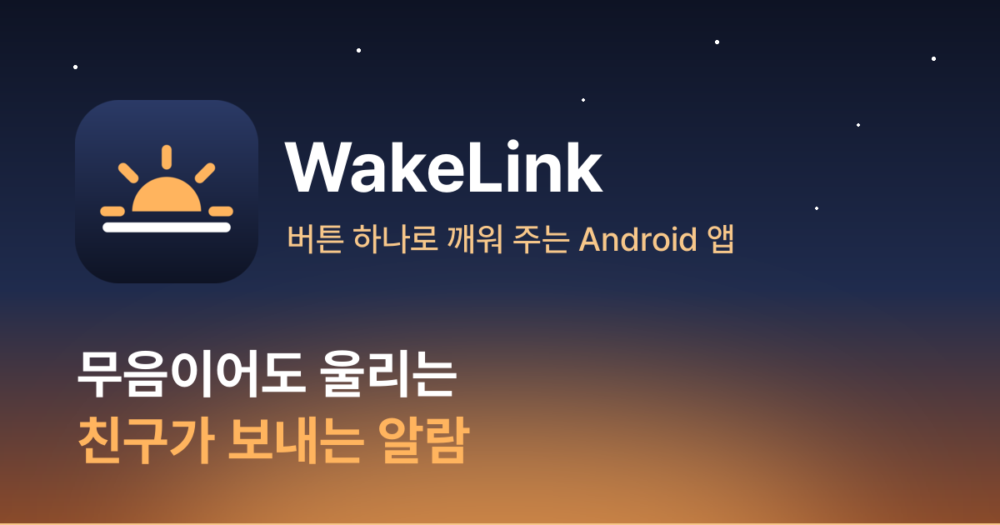
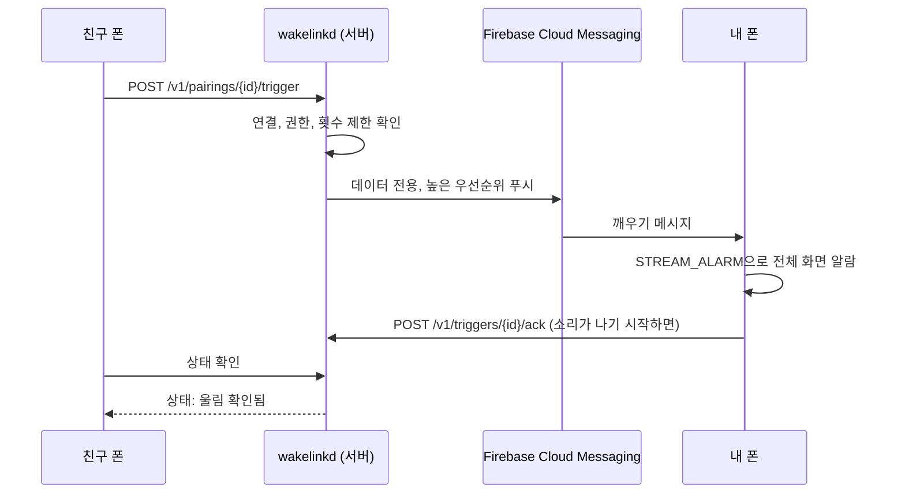

  

  
  
  

  <a href="README.md">English</a> · <b>한국어</b>

  <a href="https://wake.seolcu.com/download"><b>Android 앱 받기</b></a>
  &nbsp;·&nbsp;
  <a href="https://wake.seolcu.com"><b>웹사이트</b></a>

---

**WakeLink는 믿는 사람의 폰에서 원할 때 큰 알람을 울려 주는 앱이에요.**
상대 폰이 무음 모드여도 울려요. 알람 맞추는 걸 깜빡해도 친구가 대신 깨워 줄 수 있어요.

- **무음·진동 모드여도 울려요.** 특별한 권한은 필요 없어요.
- **진짜 울렸는지 알려 줘요.** "보냈다"와 "울렸다"를 구분해서 보여 줘요.
- **서로 동의한 사람끼리만 연결돼요.** 언제든 각자 끌 수 있어요.
- **내 소리, 내 사진으로 깨워요.** 기본 벨소리를 고르거나, 목소리를 녹음하거나, 오디오 파일을 보낼 수 있어요. 사진이나 GIF(그 자리에서 찍은 사진도)를 상대 알람 화면에 띄울 수 있어요.
- **종단간 암호화돼요.** 이름, 녹음, 파일, 사진은 받는 사람 폰만 열 수 있게 암호화돼요. 서버는 암호문만 전달해요.
- **받는 사람이 정해요.** 볼륨(점점 커지게 포함), 다른 사람이 고른 소리 허용 범위, 사진 표시 여부를 받는 사람이 정해요.
- **재부팅 후 잠금 해제 전에도 울려요.** 새벽 자동 재시작이 있어도 아침 알람이 와요.
- **앱은 하나예요.** 설치하면 누구든 깨울 수도, 깨워질 수도 있어요.
- **한국어와 영어를 지원해요.** 폰 언어를 따라가요.

## 설치

1. **<https://wake.seolcu.com/download>** 에서 APK를 받아요. 항상 [최신 릴리스](https://github.com/seolcu/wakelink/releases/latest)로 연결돼요.
2. 받은 파일을 열어요. 플레이 스토어 앱이 아니라서, 처음 한 번은 "출처를 알 수 없는 앱 설치"를 허용해야 해요.
3. 이름을 정하고, 깨워 줄 사람과 초대 코드를 주고받아요.
4. 앱이 깨우기에 필요한 권한(알림, 전체 화면 알람, 배터리 최적화)을 차례로 안내해요. 그래야 자는 동안에도 확실히 울려요.

그다음부터는 앱이 알아서 최신 상태를 유지해요.
앱을 열 때 새 버전을 확인하고(**설정 → 앱 업데이트**에서 직접 확인도 돼요), 받아서 설치 화면을 띄워요.
확인만 누르면 돼요.

## 무음 모드여도 울리는 이유

Android의 무음 모드는 벨소리와 알림 소리만 꺼요.
**알람 소리(`STREAM_ALARM`)는 그대로 둬요.**
그래서 시계 앱 알람은 무음이어도 울리고, WakeLink도 같은 알람 채널로 울려요.

| 폰 상태 | WakeLink가 울리나요? |
| --- | --- |
| 소리 / 진동 / 무음 | 울려요 |
| 방해 금지 (알람 허용) | 울려요 |
| 방해 금지 "완전 무음" | 설정에서 직접 켜면 울려요 (알림 정책 접근 권한). 울리는 동안만 바꾸고 끝나면 되돌려요 |

## 동의를 전제로 한 설계

- **양쪽이 동의해야 연결돼요.** 한 사람이 초대 코드를 만들고, 다른 사람이 직접 입력해야 해요. 몰래 추가하는 방법은 없어요.
- **방향별로 따로 허락해요.** "나는 깨울 수 있지만 상대는 나를 못 깨운다"도 가능하고, 각자 자기 쪽만 정해요.
- **언제든 거둘 수 있어요.** 앱 전체를 끄거나, 한 사람만 막거나, 연결을 아예 끊을 수 있어요.
- **상태가 늘 보여요.** 앱 첫 화면 맨 위에 지금 깨우기를 받는 중인지 표시되고, 바로 끌 수 있어요.
- **장난을 막아요.** 같은 사람에게는 30초에 한 번, 24시간 동안 20번까지만 보낼 수 있어요.
- **개인정보를 지켜요.** 양쪽 앱이 지원하면 깨우기 내용과 올린 파일이 종단간 암호화돼요. 올린 파일은 올린 사람이 깨울 수 있는 상대만 받을 수 있고, 계정을 삭제하면 같이 지워져요.

## 깨우기가 전달되는 과정

## 개발

| 폴더 | 내용 |
| --- | --- |
| [`server/`](server/README.md) | Go 백엔드(`wakelinkd`): 연결, 방향별 권한, FCM 푸시, SQLite, 그리고 [웹사이트](https://wake.seolcu.com) |
| [`android/`](android/) | Kotlin / Jetpack Compose 앱 |
| [`docs/`](docs/) | [연결 과정](docs/pairing-flow.md)과 [직접 호스팅](docs/self-hosting.md) 안내 |

<b>빌드와 직접 호스팅</b>

- **백엔드**: [`server/README.md`](server/README.md)를 참고하세요.
- **Android**: Android Studio에서 `android/`를 열어요. `android/app/google-services.json.example`을 `google-services.json`으로 복사하고, 푸시 알림이 실제로 동작하려면 내 Firebase 프로젝트의 파일로 바꿔야 해요.
- **나만의 서버 운영**: 푸시 알림은 Firebase 프로젝트 단위로 묶여 있어서, 서버 주소만 바꿔서는 안 돼요. 내 Firebase 프로젝트로 앱도 직접 빌드해야 해요. [`docs/self-hosting.md`](docs/self-hosting.md)에 과정이 정리되어 있어요.

개발 문서는 영어로만 작성되어 있어요.

## 라이선스

[MIT](LICENSE). Android 앱에는 [Pretendard](https://github.com/orioncactus/pretendard) 글꼴(SIL Open Font License 1.1)이 포함되어 있어요. [`android/third_party/pretendard/LICENSE.txt`](android/third_party/pretendard/LICENSE.txt)를 참고하세요.
