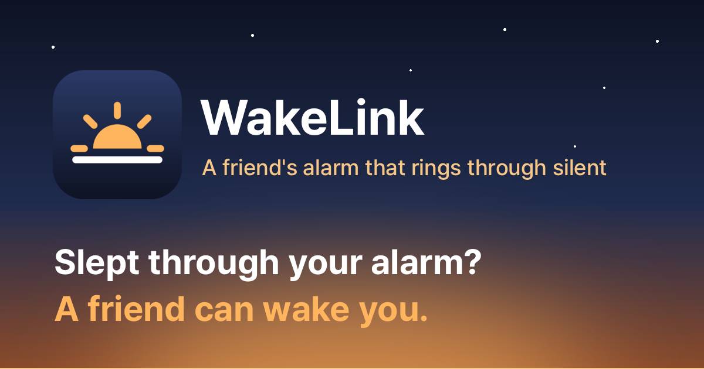
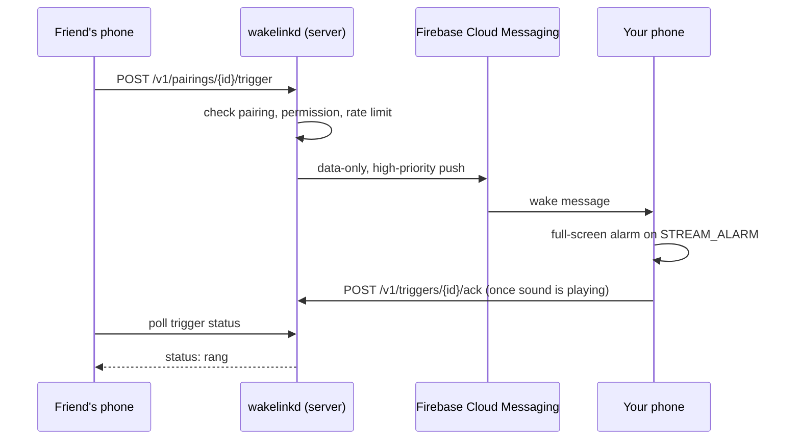

  

  
  
  

  <b>English</b> · <a href="README.ko.md">한국어</a>

  <a href="https://wake.seolcu.com/download"><b>Download for Android</b></a>
  &nbsp;·&nbsp;
  <a href="https://wake.seolcu.com"><b>Website</b></a>

---

**WakeLink rings a loud alarm on a trusted contact's phone, on demand — even when their phone is on silent.**
Forgot to set an alarm? Someone you trust can still wake you up.

- **Rings through silent and vibrate mode**, with no special permission
- **Tells the sender whether it actually rang**, not just that it was sent
- **Only people who both agreed can connect**, and either side can stop it anytime
- **Your sound, your picture**: pick a built-in sound, record your voice or send an audio file, and attach a photo or GIF (even one you take on the spot) to show on their alarm screen
- **End-to-end encrypted**: names, recordings, files and pictures are encrypted for the receiver's phone; the server only relays ciphertext
- **The receiver stays in control** of volume (with an optional gradual rise), which sounds others may choose, and whether pictures show
- **Rings even before the first unlock** after a reboot, e.g. an overnight auto-restart
- **One app for everyone**: every install can wake others and be woken
- **English and Korean**, following your phone's language

## Install

1. Download the APK from **<https://wake.seolcu.com/download>** (it always points to the [latest release](https://github.com/seolcu/wakelink/releases/latest)).
2. Open it. WakeLink isn't on the Play Store, so the first time Android asks you to allow installing apps from your browser or file manager.
3. Pick a name and swap an invite code with the person who'll wake you.
4. The app walks you through the permissions a wake needs (notifications, full-screen alarm, battery optimization), so it rings reliably while you sleep.

After that the app keeps itself up to date: it checks for a new release whenever it opens (or under **Settings → App updates**), downloads it, and opens the installer. You just confirm.

## Why it rings even on silent

Android's silent mode mutes ringtones and notification sounds, but **not the alarm stream** (`STREAM_ALARM`). That's why your clock app still goes off on silent, and WakeLink rings on that same stream.

| Phone mode | Does WakeLink ring? |
| --- | --- |
| Sound on / Vibrate / Silent | Yes |
| Do Not Disturb (alarms allowed) | Yes |
| Do Not Disturb "Total silence" | Only if you opt in under Settings (Notification Policy Access); changed just while ringing, then restored |

## Consent, by design

- **Mutual pairing**: one person creates an invite code and the other has to type it in. Nobody can be added behind their back.
- **Permission per direction**: "I can wake you, but you can't wake me" is a valid setup, and each side controls its own.
- **Always revocable**: turn the app off, block one person, or disconnect entirely, anytime.
- **Never hidden**: while people can wake you, a persistent notification says so.
- **No spamming**: one wake-up per person every 30 seconds, at most 20 per 24 hours.
- **Private by design**: wake details and uploads are end-to-end encrypted when both apps support it; uploads can only be fetched by people the uploader may wake, and are deleted with the account.

## How a wake-up travels

## Development

| Directory | What's inside |
| --- | --- |
| [`server/`](server/README.md) | Go backend (`wakelinkd`): pairing, per-direction permissions, FCM pushes, SQLite, and the [website](https://wake.seolcu.com) |
| [`android/`](android/) | The Kotlin / Jetpack Compose app |
| [`docs/`](docs/) | [Pairing flow](docs/pairing-flow.md) and [self-hosting](docs/self-hosting.md) |

<b>Building and self-hosting</b>

- **Backend**: see [`server/README.md`](server/README.md).
- **Android**: open `android/` in Android Studio. Copy `android/app/google-services.json.example` to `google-services.json`, and replace it with your own Firebase project's file before push notifications will actually work.
- **Running your own instance**: push notifications are scoped to a Firebase project, so swapping the server URL alone isn't enough. You build the app against your own Firebase project too. [`docs/self-hosting.md`](docs/self-hosting.md) walks through it.

## License

[MIT](LICENSE). The Android app bundles the [Pretendard](https://github.com/orioncactus/pretendard) font (SIL Open Font License 1.1, see [`android/third_party/pretendard/LICENSE.txt`](android/third_party/pretendard/LICENSE.txt)).
